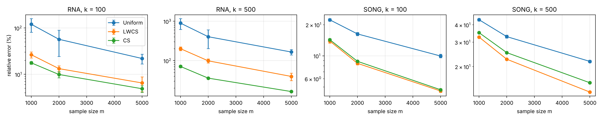
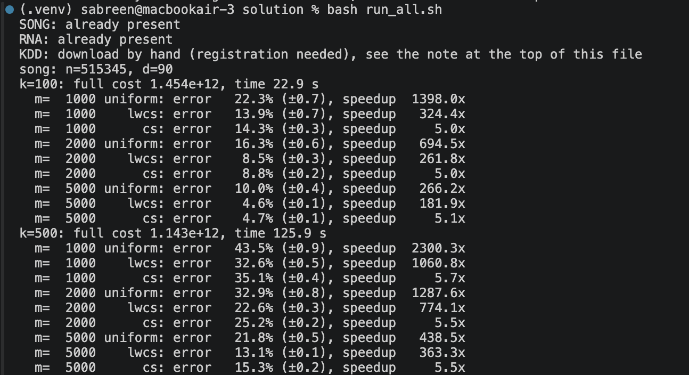
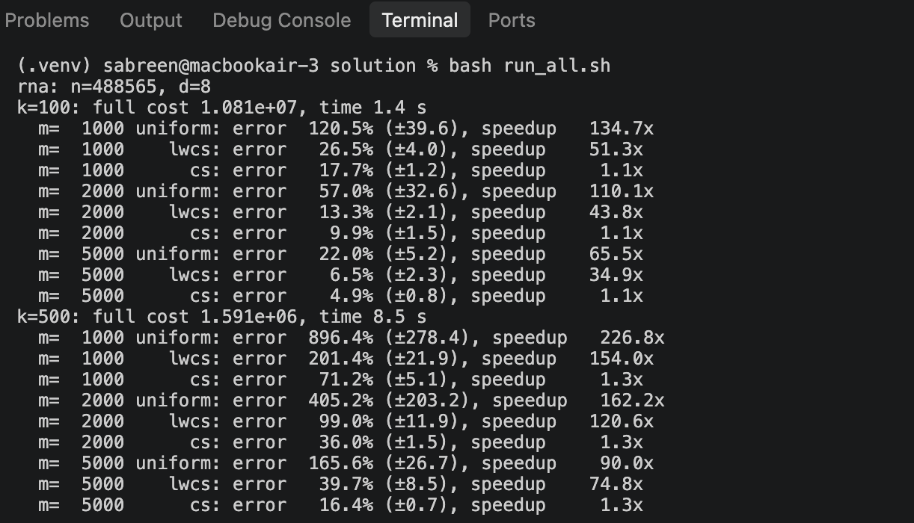
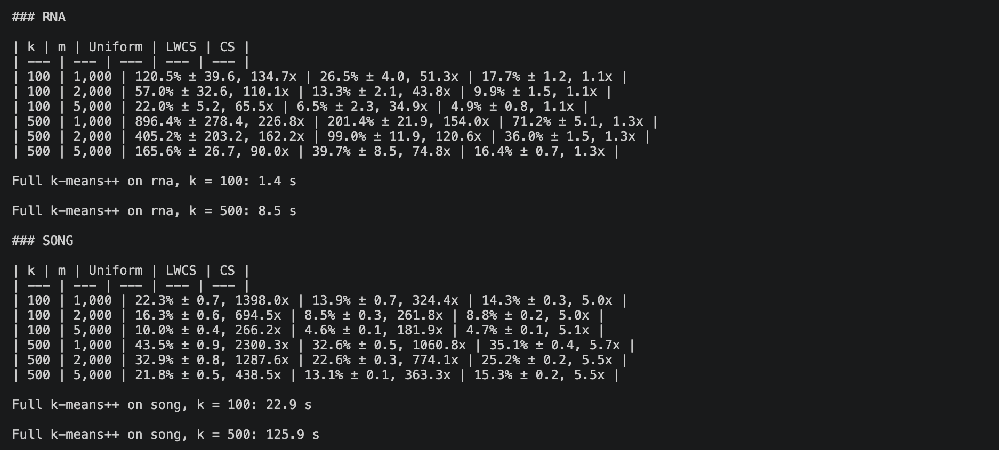

# Scalable k-Means Clustering via Lightweight Coresets: a reproduction

Reproduction of the main experiment (Table 1) of

> Olivier Bachem, Mario Lucic, Andreas Krause. **Scalable k-Means Clustering via Lightweight Coresets.** KDD 2018. [arXiv:1702.08248](https://arxiv.org/abs/1702.08248)

The paper shrinks a large dataset to a small weighted sample (a *lightweight coreset*) so that k-means can run on the sample instead of the full data. No code was released with the paper, so the algorithm and both baselines are implemented here from the paper's description.

## Repository structure

```
.
├── README.md
├── coresets.py             # Algorithm 1 (lightweight coreset), CS and Uniform baselines, k-means cost
├── reproduce_table1.py     # command-line experiment reproducing Table 1
├── run_all.sh              # SONG + RNA (and KDD if present), k = 100 and 500, then the tables
├── make_report_tables.py   # Markdown tables + error_vs_m.png from results/*.csv
├── experiment_notebook.ipynb  # the same experiment step by step, with a plot
├── requirements.txt
├── datasets/
│   ├── download_datasets.py   # downloads SONG and RNA; KDD needs a manual download
│   └── cod-rna.all            # RNA, included (38 MB); SONG is too big for GitHub
├── results/                # CSV + JSON output of each run, plot, terminal screenshots
└── tests/
    └── test_coresets.py    # unbiasedness and sanity checks
```

## Setup

Python 3.9 or newer.

```
python -m venv .venv && source .venv/bin/activate   # Windows: .venv\Scripts\activate
pip install -r requirements.txt
python -m pytest tests                              # 4 tests, a few seconds
```

## Data

| Paper name | Rows x columns | Source | How to get it |
| --- | --- | --- | --- |
| KDD | 145,751 x 74 | KDD Cup 2004 protein homology (`bio_train.dat`) | Register at [osmot.cs.cornell.edu/kddcup](https://osmot.cs.cornell.edu/kddcup/datasets.html), extract, copy `bio_train.dat` to `datasets/` |
| SONG | 515,345 x 90 | [UCI YearPredictionMSD](https://archive.ics.uci.edu/dataset/203/yearpredictionmsd) | `python datasets/download_datasets.py song` (448 MB, over GitHub's 100 MB file limit, so not included) |
| RNA | 488,565 x 8 | [LIBSVM cod-rna](https://www.csie.ntu.edu.tw/~cjlin/libsvmtools/datasets/binary.html) (the three files joined) | Included as `datasets/cod-rna.all`; or `python datasets/download_datasets.py rna` |
| CSN | 80,000 x 17 | Community Seismic Network accelerometer data | Not public; not reproduced |

Labels and ID columns are dropped; only the feature columns are clustered. No scaling is applied, since the paper does not mention any.

## Running the experiment

From the repository root:

```
python reproduce_table1.py --dataset synthetic --k 100 --reps 5   # quick check, no download
python reproduce_table1.py --dataset kdd  --k 100 500
python reproduce_table1.py --dataset song --k 100 500 --reps 10
python reproduce_table1.py --dataset rna  --k 100 500
```

Or run everything at once with `bash run_all.sh` (set `REPS=50` for the paper's setting); it ends by running `make_report_tables.py`.

Each run prints a table and writes `results/<dataset>_table1.csv` and `results/<dataset>_run.json` (all arguments used). The CSV also holds the mean time per sample run (`time_s`) and the full-run time (`full_time_s`). Or open `experiment_notebook.ipynb` and set `DATASET`.

### Metrics

- **Relative error** η = (φ_X(Q_coreset) − φ_X(Q_full)) / φ_X(Q_full), where φ_X(Q) is the k-means cost of centres Q on the full data. The paper describes η only in words; this is the standard definition.
- **Speedup** = time of k-means++ on the full data ÷ (time to build the coreset + time of k-means++ on it).

## Parameters

| Parameter | Flag | Value used | Paper |
| --- | --- | --- | --- |
| Dataset | `--dataset`, `--data-path` | kdd, song, rna, synthetic | KDD, CSN, SONG, RNA |
| Number of clusters k | `--k` | 100, 500 | 100, 500 |
| Coreset size m | `--m` | 1,000, 2,000, 5,000 | 1,000 to 20,000 (Table 1 shows 1,000 to 5,000) |
| Methods | `--methods` | uniform, lwcs, cs | Uniform, LWCS, CS |
| Repetitions | `--reps` | 10 | 50 |
| Full-data reference runs | `--full-reps` | 3, averaged | not stated |
| Solver | fixed | scikit-learn `KMeans`, `init="k-means++"`, `n_init=1`, weighted | "k-means++" |
| Lloyd iterations | `--max-iter` | 300 | not stated |
| Sampling | fixed | with replacement | Algorithm 1 |
| CS constant α | fixed | 16 (log k + 2) | Lucic et al. 2016 |
| Seeds | fixed | coreset RNG 1000 + rep; k-means `random_state` = rep | not stated |

## Results

SONG and RNA, 10 repetitions per setting (`results/`). Each cell: mean relative error ± 95% CI, then mean speedup. Paper values from Table 1 (50 repetitions) in brackets.

**SONG** (full k-means++: 22.9 s at k = 100, 125.9 s at k = 500)

| k | m | Uniform | LWCS | CS |
| --- | --- | --- | --- | --- |
| 100 | 1,000 | 22.3% ± 0.7, 1398x [22.4%, 8027x] | 13.9% ± 0.7, 324x [14.9%, 1168x] | 14.3% ± 0.3, 5.0x [14.6%, 145x] |
| 100 | 2,000 | 16.3% ± 0.6, 694x [16.0%, 2912x] | 8.5% ± 0.3, 262x [9.9%, 958x] | 8.8% ± 0.2, 5.0x [9.3%, 139x] |
| 100 | 5,000 | 10.0% ± 0.4, 266x [10.0%, 640x] | 4.6% ± 0.1, 182x [5.2%, 509x] | 4.7% ± 0.1, 5.1x [4.9%, 127x] |
| 500 | 1,000 | 43.5% ± 0.9, 2300x [43.0%, 4952x] | 32.6% ± 0.5, 1061x [31.4%, 2741x] | 35.1% ± 0.4, 5.7x [33.0%, 138x] |
| 500 | 2,000 | 32.9% ± 0.8, 1288x [32.3%, 2866x] | 22.6% ± 0.3, 774x [22.7%, 2052x] | 25.2% ± 0.2, 5.5x [23.9%, 134x] |
| 500 | 5,000 | 21.8% ± 0.5, 439x [21.4%, 992x] | 13.1% ± 0.1, 363x [14.2%, 914x] | 15.3% ± 0.2, 5.5x [14.7%, 128x] |

**RNA** (full k-means++: 1.4 s at k = 100, 8.5 s at k = 500)

| k | m | Uniform | LWCS | CS |
| --- | --- | --- | --- | --- |
| 100 | 1,000 | 120.5% ± 39.6, 135x [98.5%, 774x] | 26.5% ± 4.0, 51x [29.5%, 115x] | 17.7% ± 1.2, 1.1x [20.7%, 11x] |
| 100 | 2,000 | 57.0% ± 32.6, 110x [46.8%, 414x] | 13.3% ± 2.1, 44x [18.3%, 102x] | 9.9% ± 1.5, 1.1x [12.4%, 11x] |
| 100 | 5,000 | 22.0% ± 5.2, 66x [23.5%, 161x] | 6.5% ± 2.3, 35x [8.4%, 72x] | 4.9% ± 0.8, 1.1x [5.3%, 10x] |
| 500 | 1,000 | 896.4% ± 278.4, 227x [786.5%, 58x] | 201.4% ± 21.9, 154x [189.2%, 50x] | 71.2% ± 5.1, 1.3x [68.8%, 8x] |
| 500 | 2,000 | 405.2% ± 203.2, 162x [312.1%, 52x] | 99.0% ± 11.9, 121x [88.0%, 49x] | 36.0% ± 1.5, 1.3x [36.4%, 8x] |
| 500 | 5,000 | 165.6% ± 26.7, 90x [163.4%, 48x] | 39.7% ± 8.5, 75x [39.5%, 39x] | 16.4% ± 0.7, 1.3x [17.8%, 8x] |



**The relative errors reproduce the paper closely.** Almost every value is within a few percentage points of Table 1, and the ranking of the methods is the same: on SONG, LWCS is as good as or slightly better than CS; on RNA, LWCS is clearly better than Uniform but worse than CS, most of all at k = 500 (201% against 71% at m = 1,000).

### Terminal output of the runs

`bash run_all.sh` on a MacBook Air (Apple M1, 2020, 16 GB RAM), Python 3.9:

| SONG | RNA |
| --- | --- |
|  |  |



## Differences from the paper and likely reasons

- **Speedups are smaller, and CS is barely faster than the full run.** Speedup is measured against k-means++ on the full data, and scikit-learn's multi-threaded implementation is much faster than the paper's baseline (345 s for KDD at k = 100; here 22.9 s for SONG). A fast baseline shrinks every ratio. CS is slowest because its k-means++ seeding (k passes over the data) is written in plain NumPy; on SONG it takes about 4.6 s at k = 100, close to the full run. The ordering Uniform > LWCS > CS in speed is the same as in the paper.
- **On RNA at k = 500 our speedups are higher than the paper's** (154x against 50x for LWCS at m = 1,000). The paper does not report its absolute times for RNA, so the cause is unclear; ours compare 8.5 s for the full run with 0.06 to 0.11 s for LWCS. Speedups depend on hardware and implementation, so only their ordering is comparable.
- **Wider confidence intervals for Uniform on RNA** (for example ±39.6 against ±9.8) because of 10 instead of 50 repetitions and because Uniform sometimes misses whole clusters, which gives occasional very bad runs.
- **Solver details** (Lloyd iterations, restarts) and **preprocessing** are not given in the paper; we used 300 iterations, one k-means++ restart and no scaling.
- **KDD and CSN are not reproduced.** KDD needs a registration that did not return a download link, and CSN is not public.

## Use of generative AI

The implementation was written with help from a generative AI assistant, as the assignment allows, and checked with the tests in `tests/` and against the paper's description of Algorithm 1.
